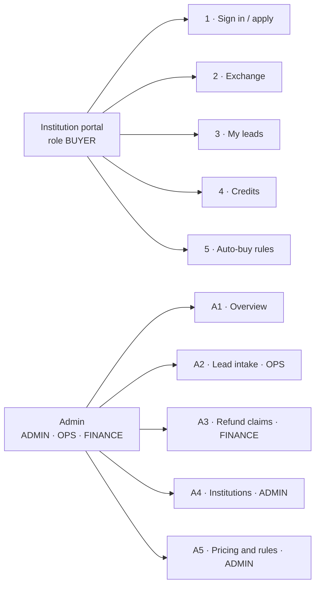
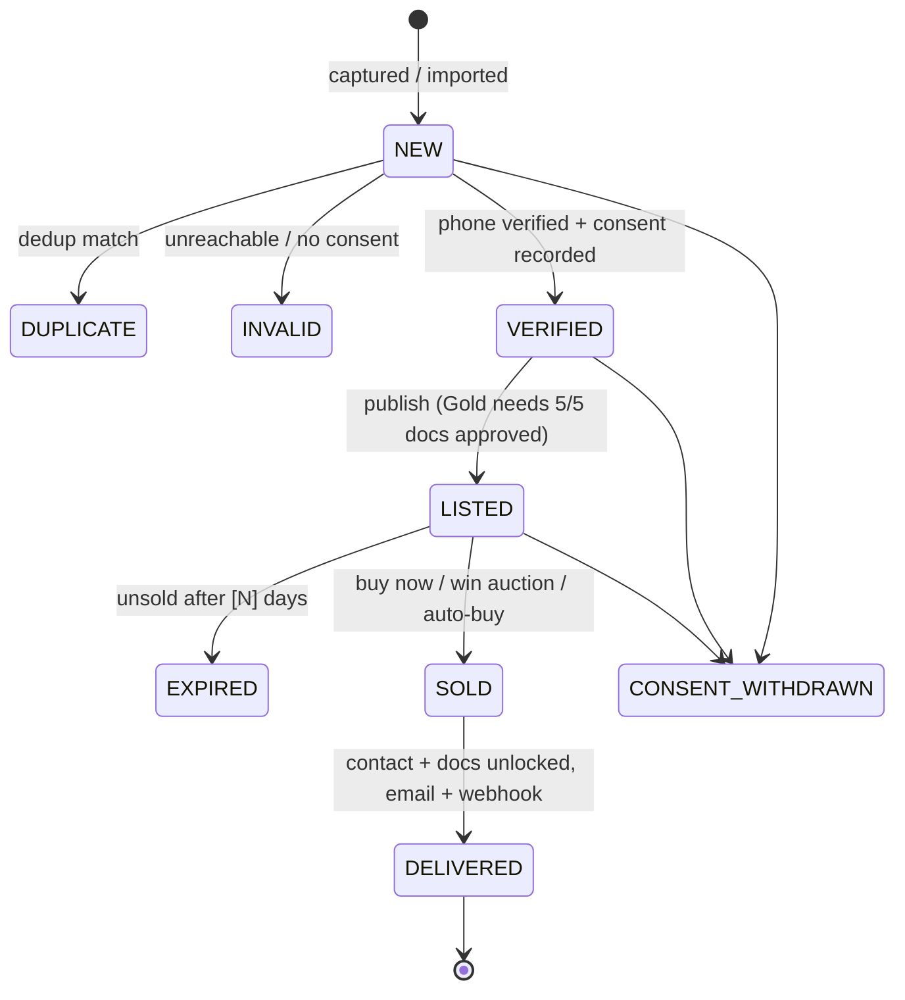
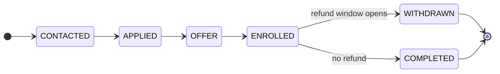
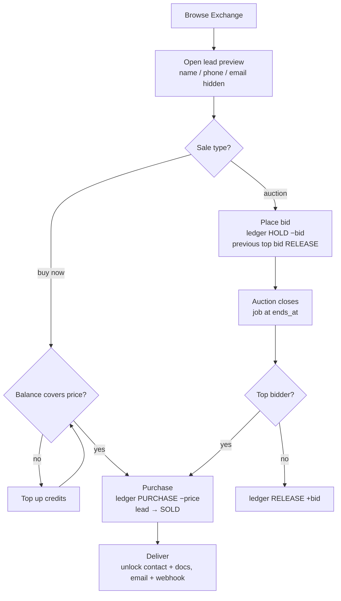
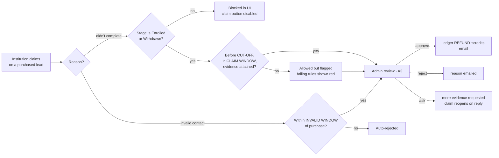
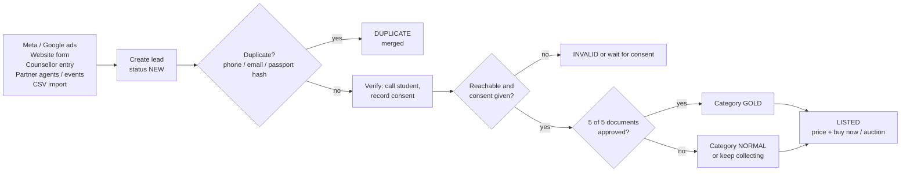
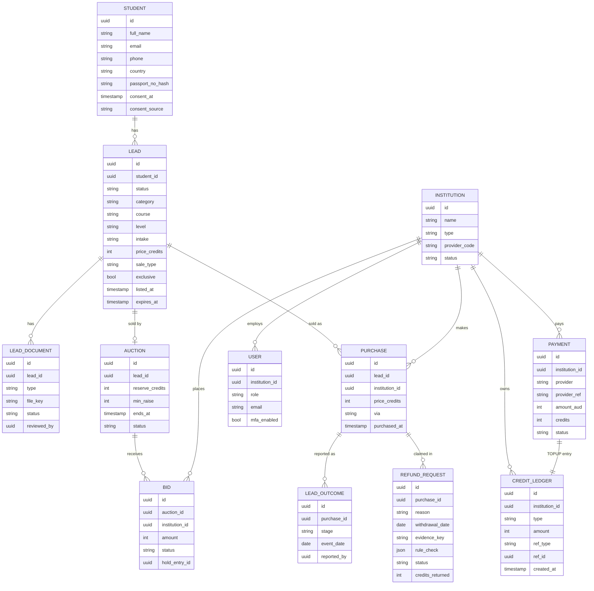

# Flows for the dev team

The same flows as the **Flows for developers** page of the [design canvas](../design/README.md), written as Mermaid so GitHub renders them. Values in `[BRACKETS]` are business decisions still open (see [PRODUCT_DESIGN.md](PRODUCT_DESIGN.md) §14). The admin sets them on screen A5 · Pricing and rules.

## F1 · Screen map

An institution applies, an admin approves it on A4, and only then can its users buy.

## F2 · Lead lifecycle

`Lead.status` is set by our team. Once a lead is sold, `Purchase.stage` is set by the institution. **Gold vs Normal is a category, not a status.**

## F3 · Buy now and auction

Rules for the build:

- **Purchase transaction:** a purchase is a single DB transaction. Lock the lead row, check that it's still `LISTED`, check the balance, write the ledger entry, create the `Purchase`, and set the lead to `SOLD`.
- **Exclusive leads:** an exclusive lead is sold once. A second buyer sees "just sold" and is not charged.
- **Balance:** the balance is always `SUM(credit_ledger.amount)` for the institution. Never store it as an editable number.
- **Late bids:** a bid in the last `[N]` minutes extends the auction.
- **Auctions without a sale:** if no bid meets the reserve, the lead goes back to buy now.
- **Auto-buy:** rules run when a lead becomes `LISTED`, and only for buy-now leads.

## F4 · Refund claim

**Core rule:** a refund is allowed only if the student **enrolled and then didn't complete**, or the **contact details were invalid**. A student who doesn't reply, doesn't enrol, or chooses another provider is never refundable.

`RefundRequest.rule_check` stores the result of each rule (enrolled, before cut-off, within window, evidence) so FINANCE sees them on A3.

## F5 · Lead intake to Gold

Gold documents: passport, transcripts and certificates, English test result, statement of purpose / GTE, financial evidence. A counsellor approves or rejects each one. A rejection emails the student a link to upload it again.

## F6 · Data model

`CREDIT_LEDGER` is append-only. Every create, update and document view also writes an `AUDIT_LOG` row (actor, action, entity, entity_id, at).
